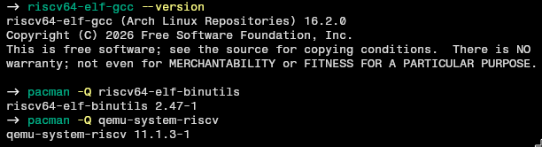
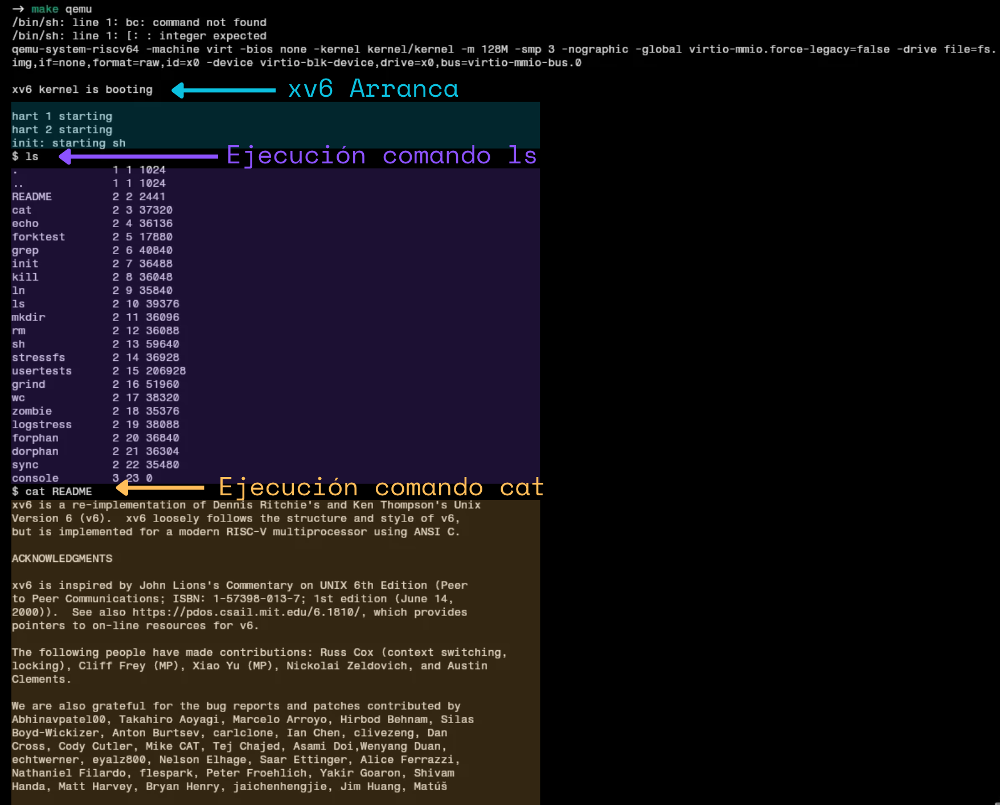
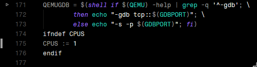
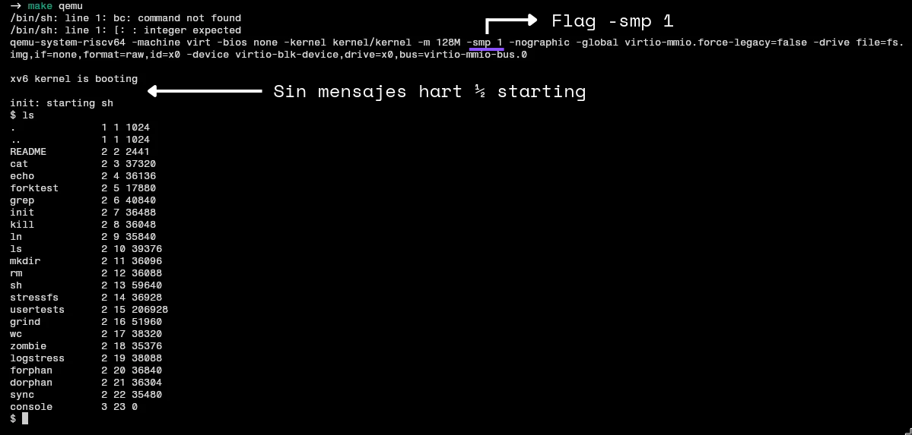
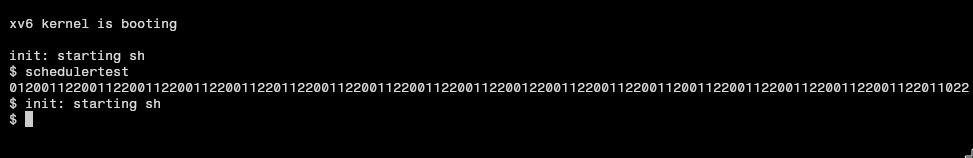
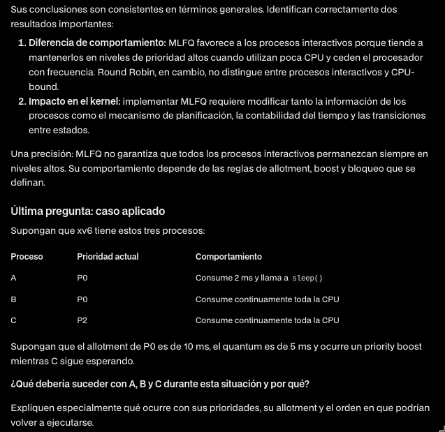
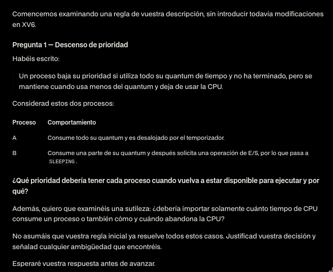
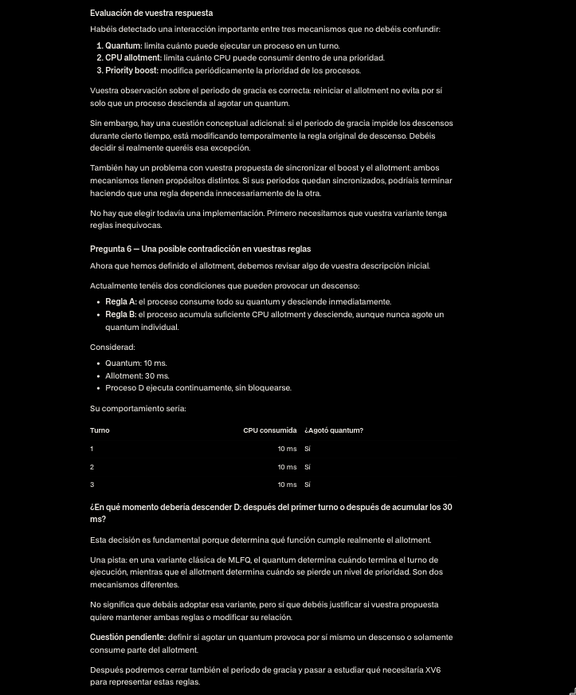

# Reporte — Teoría Algoritmo MLFQ
**Fecha:** 11 de noviembre del 2026

## Integrantes:
- Yostin Ramirez - 2519674
- Joseph Terreros - 2521011

## 1. Entorno:
- **Sistema:** `Linux 7.2.14-arch1-1 x86_64`
- **ID Commit de Partida:** `fa2ddcb7ca87a77af579380a6eafd5aff163b44f`
- **Herramientas de Compilación:**


## 2. Compilar y Ejecutar xv6:


---

### Cambiar el Número de CPU's Virtuales
Se consultó con Gemini como, nos dijo que para hacerlo de forma permanente debiamos modificar una variable Makefile:

Aquí cambiamos `CPUS := 3` (Valor por defecto) por: `CPUS := 1`

Para evidenciarlo, Gemini dijo que bastaba con notar que al iniciar xv6, los mensajes:
```sh
hart 1 starting
hart 2 starting
```
No saldrían, además de que qemu sería invocado con la bandera `-smp 1` en vez de `-smp 3` y en efecto así ocurrió:


## 3. Planificador Original
Aquí lo hicimos al revez, encontramos primero la solución al subpunto ii antes que el i, debido a que no teniamos idea de como comprobar el algoritmo de planificación en el sistema en base a su comportamiento mientras corría, entonces optamos por buscar en los archivos alguna pista:

---

### Donde se Implementa el Algoritmo de Planificación Actual
**ii.** Empezamos mirando los archivos de la carpeta `kernel/`, pensamos que quizas en `sysproc.c` estaría pero no, al parecer aqui se alojan funciones que se ejecutan sobre procesos. Luego vimos el archivo `proc.c` este se vió mucho más prometedor ya que tenía responsabilidades propias de un archivo que contenga el scheduler o su funcionamiento, buscamos aqui hasta que vimos la linea `363` la función `sched()` y un comentario "`Jump into the scheduler, ...`" entonces buscamos esta función y justo unas lineas antes estaba lo que buscamos, la función `scheduler()` y la revisamos, pero realmente no comprendimos su funcionamiento, entonces buscamos en el anexo de la documentación oficial información acerca de esto, vimos que en la lectura explicaban el código en el apartado *Code: Scheduling* además de que justo después, en el apartado *Real World* dice explicitamente que xv6 usa el algoritmo o politica **Round-Robin**.

---

### Que Algoritmo de Planificación usa xv6 Actualmente
**i.** Una vez conociendo que el algoritmo era un Round-Robin, para comprobarlo debiamos ejecutar 2 o más procesos, y de alguna forma poder ver en todo momento el estado de esos procesos, al ser round robin, deben intercalarse de forma equitativa.

Al ser un sistema desconocido para nosotros, no sabiamos como realizar esto, entonces Claude nos sugirió 2 opciones, o usar un script para comprobarlo (similar a las pruebas que hacemos en clase) o realizarlo mediante scripts o comandos ya existentes en el sistema.

Optamos primero intentar la segunda opción, Claude sugirió:
- Ejecutar `usertests &`
- Mientras `usertests` corre, ejecutar `Ctrl + P`, esto desplegaría una tabla donde se pueden ver los procesos corriendo y su estado, si es Round-Robin deberían intercalar entre `run` y `runble`

Lo pusimos en practica, y aunque es verdad que si cambiaban, es muy incomodo y dificil de ver, ya que a pesar de haber ejecutado el comando como segundo plano (`&`), seguía imprimiendo las salidas en la terminal, entonces la salida de `Ctrl + P` y de `usertests` se combinaban, lo que dificultaba leer e interpretar los estados, además de que ya sea por la limitada velocidad humana a la que se puede presionar `Ctrl + P` no se podía apreciar bien cada momento y por esto tardaba mucho en cambiar.

Es por esto que al final optamos por ejecutar la primer sugerencia de Claude, un script que lo evidencie de forma comoda.
Claude nos ayudó a terminar la idea que teniamos en base a clases anteriores y generó este código:

```c
#include "kernel/types.h"
#include "user/user.h"

int main(void) {
  for (int i = 0; i < 3; i++) {
    if (fork() == 0) {
      for (int n = 0; n < 40; n++) {
        for (volatile int j = 0; j < 20000000; j++);
        printf("%d", i);
      }
      exit(0);
    }
  }
  for (int i = 0; i < 3; i++) wait(0);
  printf("\n");
  exit(0);
}
```

El cual hace que el proceso padre genere 3 hijos, cada hijo ejecuta lo que está dentro del `if (fork() == 0)` lo cual hace que cada hijo imprima su id 40 veces, con una pausa activa (el for j) la cual obliga al procesador a hacer 20.000.000 de comparaciones e incrementos del for en vano (ya que este for no ejecuta nada) antes de imprimir su id, consumiendo así multiples quantums de tiempo.

Como los 3 hijos están haciendo cálculos puros sin esperar entrada/salida de disco ni teclado, ninguno entra en estado `SLEEPING`. Todos permanecen en estado `RUNNABLE` compitiendo por la única CPU (configurada previamente). Cada vez que salta la interrupción del temporizador, el kernel desaloja al hijo actual y le da turno al siguiente en la tabla de procesos.

Para poder correr el script, creamos un archivo `schedulertest.c` en `user/`, lo añadimos al `Makefile` en la lista de `UPROGS=` y luego ejecutamos xv6 recompilandolo como siempre `make qemu`



Como se puede ver, la salida fue: `01200112200112200112200...` un patrón casi perfecto de `00 11 22` en bucle, lo que demuestra que usa Round-Robin, ya que se ve como los procesos se intercalan equitativamente la CPU (los pequeños desfases pueden deberse a pequeñas desincronizaciones de los procesos, quantum, o incluso retrasos del printf etc.) 

---

### Selección, Estados y Eventos
**iii.** Con ayuda de Claude y la documentación pudimos entender: la función `scheduler()` elige el siguiente proceso recorriendo la tabla `proc[NPROC]` en orden y tomando el primero `RUNNABLE`, ese cambio de `RUNNABLE` a `RUNNING` es la entrada a la CPU.

**Selección:** Para cada entrada de la tabla, el scheduler toma `p->lock` y, si `p->state == RUNNABLE`, hace lo siguiente:

1. Cambia el estado a `RUNNING`.
2. Asigna `c->proc = p`.
3. Ejecuta `swtch(&c->context, &p->context)`, que entrega la CPU al proceso.

Al volver pone `c->proc = 0` y sigue con la siguiente entrada. Si una pasada completa no encuentra nada, la CPU ejecuta `wfi`

**Estados:** `UNUSED`, `USED`, `SLEEPING`, `RUNNABLE`, `RUNNING`, `ZOMBIE`

De estos, los procesos que van a entrar a la CPU están en `RUNNABLE` y pasan a `RUNNING` cuando `scheduler()` los selecciona, mientras que el que ya está en la CPU se encuentra en `RUNNING` y solo sale de ese estado cuando cede la CPU.

**Eventos que ceden la CPU:** Todos terminan en `sched()`, que hace `swtch` de vuelta al scheduler

| Evento | Dónde | Transición |
| --- | --- | --- |
| Interrupción de timer | `usertrap()` (`trap.c:85`) y `kerneltrap()` (`trap.c:157`) llaman a `yield()` | `RUNNING` a `RUNNABLE` (`proc.c:505`) |
| Bloqueo | `sleep()` tras `sleep_prepare(chan)` | `RUNNING` a `SLEEPING` (`proc.c:568`) |
| Terminación | `kexit()` | `RUNNING` a `ZOMBIE` (`proc.c:358`) |

El quantum lo marca `clockintr()`, que reprograma el timer con `stimecmp + 1000000`, unos 0.1 s según el comentario del código.

**Eventos que recuperan la CPU:** Es decir, que dejan al proceso elegible de nuevo

- `wakeup(chan)` pasa `SLEEPING` a `RUNNABLE` (`proc.c:590`).
- `kkill()` hace lo mismo con un proceso dormido (`proc.c:614`).
- Los procesos nuevos nacen `RUNNABLE`, en `userinit` (`proc.c:228`) y `kfork` (`proc.c:301`).

---

### Incorporación del Algoritmo de Planificación
**iv.** El proceso que se sigue para que el scheduler quede compilado en el sistema operativo es: 
1. Listado en los objetos del Kernel (`OBJS` en el `Makefile`):

    En el `Makefile` existe una variable llamada `OBJS` que enumera todos los archivos objeto (.o) que conforman el núcleo del sistema operativo.

    Ahí aparece explícitamente `$K/proc.o` (que corresponde a `kernel/proc.c`, donde vimos que vive `scheduler()`).

2. Compilación:

    Cuando se ejecuta `make qemu`, el compilador (`riscv64-linux-gnu-gcc`) toma el código en C de `kernel/proc.c` y lo traduce a instrucciones de arquitectura RISC-V, generando el archivo objeto binario `kernel/proc.o`

3. Enlazado (Linking) en el binario único del Kernel:

    Una vez compilados todos los .o de la lista `OBJS`, el enlazador o linker (`riscv64-linux-gnu-ld`) toma `kernel/proc.o` y los une o enlaza con el resto de los módulos del sistema (memoria, interrupciones, sistema de archivos, etc.) siguiendo las reglas de direcciones de memoria definidas en el script `kernel/kernel.ld`

    El resultado de esta unión es un único archivo ejecutable ELF (propio de sistemas operativos) llamado `kernel/kernel`

4. Carga en la memoria de la máquina virtual:

    Finalmente, cuando `make qemu` lanza el emulador, le pasa el parámetro `-kernel kernel/kernel`. QEMU carga ese archivo binario directamente en la memoria RAM emulada de la CPU RISC-V y, una vez que el kernel termina su inicialización (`main()` en `kernel/main.c`), cada núcleo llama a `scheduler()` para empezar a ejecutar procesos.

## 4. Incorporación Teórica MLFQ

### Prompt y Descripción Propia
`IA utilizada: ChatGPT 6-Luna`

Actúa como tutor socrático de una pareja de estudiantes de cuarto semestre de Ingeniería de Sistemas. Conocemos C++ y hemos comenzado a explorar XV6 para RISC-V.

Queremos identificar y justificar qué se necesitaría para incorporar MLFQ a XV6. En esta entrega no vamos a implementarlo.

Nuestra descripción inicial del algoritmo, escrita antes de esta conversación:

**Descripción Propia:** El algoritmo MLFQ se basa en combinar el Round-Robin, con colas de prioridad la cual está definida por las reglas del algoritmo, por ejemplo, un proceso baja su prioridad si utiliza todo su quantum de tiempo y no ha terminado pero se mantiene cuando usa menos del quantum y deja de usar la cpu, que un proceso con mayor prioridad se ejecutará sobre los de menor prioridad y cada cola usa round robin, otra regla sería que todos los procesos vuelven a la máxima prioridad después de un determinado periodo de tiempo y a pesar de que un proceso nunca use todo su quantum, tambien dado un uso de la cpu, bajará su prioridad

**Dudas Detectadas:** Esta demostrado que MLFQ es realmente eficiente? y si lo está, que tanto lo es en comparación con otros algoritmos o politicas famosas o conocidas? Nos parece algo confuso el como es mejor que un Round-Robin clásico, si de igual forma los procesos en un punto tienen que reiniciar su prioridad al máximo y procesos que están en la prioridad máxima tarde o temprano bajarán debido a la última regla que describimos.

Lo que averiguamos del planificador original y de su incorporación al sistema compilado:

**Planificador Original:** Empezamos mirando los archivos de la carpeta `kernel/`, pensamos que quizas en `sysproc.c` estaría pero no, luego vimos el archivo `proc.c` este se vió mucho más prometedor, encontramos la función `scheduler()` y la revisamos, pero realmente no comprendimos su funcionamiento, entonces buscamos en la documentación oficial información acerca de esto, vimos que en la lectura, en el apartado *Real World* dice explicitamente que xv6 usa el algoritmo o politica **Round-Robin**.

**Comprobación:** Para comprobar que el algoritmo es Round-Robin debiamos ejecutar 2 o más procesos, y de alguna forma poder ver en todo momento el estado de esos procesos, al ser round robin, deben intercalarse de forma equitativa.

Optamos por hacer un script que lo evidencie:

```c
#include "kernel/types.h"
#include "user/user.h"

int main(void) {
  for (int i = 0; i < 3; i++) {
    if (fork() == 0) {
      for (int n = 0; n < 40; n++) {
        for (volatile int j = 0; j < 20000000; j++);
        printf("%d", i);
      }
      exit(0);
    }
  }
  for (int i = 0; i < 3; i++) wait(0);
  printf("\n");
  exit(0);
}
```

La salida fue: `01200112200112200112200...` un patrón casi perfecto de `00 11 22` en bucle, lo que demuestra que usa Round-Robin, ya que se ve como los procesos se intercalan equitativamente la CPU (los pequeños desfases pueden deberse a pequeñas desincronizaciones de los procesos, quantum, o incluso retrasos del printf etc.) 

**Selección:** Para cada entrada de la tabla, el scheduler toma `p->lock` y, si `p->state == RUNNABLE`:

1. Cambia el estado a `RUNNING`.
2. Asigna `c->proc = p`.
3. Ejecuta `swtch(&c->context, &p->context)`, que entrega la CPU al proceso.

Al volver pone `c->proc = 0` y sigue con la siguiente entrada. Si una pasada completa no encuentra nada, la CPU ejecuta `wfi`

**Estados:** `UNUSED`, `USED`, `SLEEPING`, `RUNNABLE`, `RUNNING`, `ZOMBIE`

De estos, los procesos que van a entrar a la CPU están en `RUNNABLE` y pasan a `RUNNING` cuando `scheduler()` los selecciona, mientras que el que ya está en la CPU se encuentra en `RUNNING` y solo sale de ese estado cuando cede la CPU.

**Eventos que ceden la CPU:** Todos terminan en `sched()`, que hace `swtch` de vuelta al scheduler

| Evento | Dónde | Transición |
| --- | --- | --- |
| Interrupción de timer | `usertrap()` (`trap.c:85`) y `kerneltrap()` (`trap.c:157`) llaman a `yield()` | `RUNNING` a `RUNNABLE` (`proc.c:505`) |
| Bloqueo | `sleep()` tras `sleep_prepare(chan)` | `RUNNING` a `SLEEPING` (`proc.c:568`) |
| Terminación | `kexit()` | `RUNNING` a `ZOMBIE` (`proc.c:358`) |

El quantum lo marca `clockintr()`, que reprograma el timer con `stimecmp + 1000000`, unos 0.1 s según el comentario del código.

**Eventos que recuperan la CPU:** Es decir, que dejan al proceso elegible de nuevo

- `wakeup(chan)` pasa `SLEEPING` a `RUNNABLE` (`proc.c:590`).
- `kkill()` hace lo mismo con un proceso dormido (`proc.c:614`).
- Los procesos nuevos nacen `RUNNABLE`, en `userinit` (`proc.c:228`) y `kfork` (`proc.c:301`).

**Incorporación Scheduler:**
1. Listado en los objetos del Kernel (`OBJS` en el `Makefile`):

    En el `Makefile` existe una variable llamada `OBJS` que enumera todos los archivos objeto (.o) que conforman el núcleo del sistema operativo.

    Ahí aparece explícitamente `$K/proc.o` (que corresponde a `kernel/proc.c`, donde vimos que vive `scheduler()`).

2. Compilación:

    Cuando se ejecuta `make qemu`, el compilador toma el código en C de `kernel/proc.c` y lo traduce a instrucciones de arquitectura RISC-V, generando el archivo objeto binario `kernel/proc.o`

3. Enlazado (Linking) en el binario único del Kernel:

    Una vez compilados todos los .o de la lista `OBJS`, el enlazador o linker toma `kernel/proc.o` y los une o enlaza con el resto de los módulos del sistema (memoria, interrupciones, sistema de archivos, etc.) siguiendo las reglas de direcciones de memoria definidas en el script `kernel/kernel.ld`

    El resultado de esta unión es un único archivo ejecutable ELF (propio de sistemas operativos) llamado `kernel/kernel`

4. Carga en la memoria de la máquina virtual:

    Finalmente, cuando `make qemu` lanza el emulador, le pasa el parámetro `-kernel kernel/kernel`. QEMU carga ese archivo binario directamente en la memoria RAM emulada de la CPU RISC-V y, una vez que el kernel termina su inicialización (`main()` en `kernel/main.c`), cada núcleo llama a `scheduler()` para empezar a ejecutar procesos.

Reglas de interacción:

1. Formula una sola pregunta principal por turno y espera nuestra respuesta. No presentes una lista completa de cambios ni una arquitectura resuelta.
2. Empieza examinando nuestra descripción de MLFQ. Ayúdanos a detectar reglas ambiguas, ausentes o contradictorias. No sustituyas nuestra descripción por una versión terminada ni elijas silenciosamente una variante del algoritmo.
3. Pídenos que propongamos y justifiquemos las decisiones que faltan. Después, ayúdanos a comprobarlas con ejemplos pequeños de procesos y decisiones de planificación que nosotros debamos resolver.
4. Guíanos para relacionar cada regla con XV6. Antes de sugerir una modificación, pregúntanos qué comportamiento necesitamos y qué evidencia del código respalda nuestra propuesta.
5. No supongas que tienes acceso a nuestro repositorio. Pide los fragmentos necesarios y distingue lo observado de lo que todavía sea una hipótesis. No inventes archivos, funciones o comportamientos de nuestra versión.
6. No entregues código de implementación, parches, una lista cerrada de archivos por modificar ni pseudocódigo que resuelva el planificador. Revisa nuestras propuestas y señala problemas mediante preguntas y pistas graduales. Puedes explicar conceptos previos con ejemplos mínimos.
7. Si nos bloqueamos, reduce la dificultad de la pregunta y ofrece una pista concreta. Si pedimos la solución directa, conserva el modo socrático.

El objetivo es que nosotros logremos:

A. Redactar una descripción revisada y coherente de la variante de MLFQ considerada.

B. Explicar qué cambios necesitaría XV6 para soportarla, indicando para cada uno su propósito, su relación con las reglas y la evidencia del código que lo justifica.

C. Proponer escenarios para comprobar una futura implementación del algoritmo MLFQ en el sistema operativo XV6. Pídenos que expliquemos qué procesos participarían, qué harían, qué regla comprobaríamos y qué comportamiento esperaríamos observar. No nos entregues los escenarios resueltos. En esta tarea solo los describiremos; no vamos a programarlos ni ejecutarlos.

Mantén el análisis dentro del alcance de una propuesta: no necesitamos implementar MLFQ ni construir un selector de planificadores. Ayúdanos a registrar las cuestiones que queden pendientes de investigación.

Al finalizar, pídenos que redactemos nuestras conclusiones. Comprueba su consistencia mediante una última pregunta aplicada a un caso concreto, sin escribir por nosotros el reporte.

Comienza con una pregunta que permita comprobar cómo entendemos una regla de nuestra descripción inicial de MLFQ.

---

### Propuestas de Cambios

Estas son las decisiones que identificamos pertinentes junto con la interacción socratica de la IA, quizas requieren más investigación y analisis de si son las mejores, aunque la IA nos ayudó a identificar un par de errores en nuestra lógica.

1. **Incorporar tres niveles de prioridad**

Se propone utilizar tres niveles de prioridad (al menos al principio): P0 (alta), P1 (media) y P2 (baja). El scheduler siempre debe seleccionar procesos de la cola de mayor prioridad que tenga procesos disponibles y dentro de cada nivel se utilizará Round-Robin (en base a lo entendido del video explicativo del docente)

**Necesidad:** establecer un orden de ejecución que permita favorecer procesos que necesitan respuestas rápidas, sin dejar de atender los que requieren más tiempo de CPU.

2. **Agregar colas FIFO para cada nivel**

Se propone reemplazar el recorrido secuencial de `proc[]` como mecanismo de selección por tres colas FIFO, una para cada nivel (la IA socratica nos ayudó a entender la diferencia entre FIFO y Round-Robin, ya que en principio, pensabamos que chocaban). Así los procesos se extraerán del principio y se incorporarán al final cuando deban volver a competir por la CPU

**Necesidad:** representar explícitamente las prioridades y mantener el orden Round Robin. El recorrido actual de proc[] no garantiza ese comportamiento

3. **Incorporar la contabilidad de CPU allotment**

Se propone agregar a cada proceso información sobre su prioridad actual y el tiempo de CPU que ha consumido en ese nivel. También se debe conocer cuánto allotment le queda antes de descender de prioridad.

Cada nivel tendrá un allotment definido, cuando un proceso agote el suyo, descenderá al siguiente nivel y recibirá el presupuesto correspondiente a ese nivel, P2 será el nivel mínimo y no tendrá otro descenso

**Necesidad:** evitar que los procesos que consumen mucha CPU permanezcan indefinidamente en los niveles superiores (tal como indican las reglas del MLFQ). Además, el consumo acumulado evita que un proceso evada el descenso simplemente cediendo la CPU antes de terminar cada quantum (esto evita que procesos maliciosos o malintencionados capturen la CPU)

4. **Medir el tiempo real de ejecución de cada proceso**

Se propone utilizar el contador de tiempo disponible en RISC-V, mediante `r_time()`, para medir cuánto tiempo utiliza cada proceso. La medición comenzaría cuando `scheduler()` le entrega la CPU y terminaría cuando recupera el control después de `swtch()`

El tiempo medido se acumulará en el allotment del proceso. No se contabilizará el tiempo que permanezca en estado `SLEEPING`

**Necesidad:** obtener una contabilidad individual del consumo de CPU, el contador global ticks de `clockintr()` no permite conocer cuánto tiempo utilizó cada proceso según lo entendido con la IA socratica

5. **Establecer un quantum para cada turno de ejecución**

Se propone utilizar un quantum común para los tres niveles (al menos en la primera versión). Cuando un proceso agote su quantum, cederá la CPU y volverá al final de su cola si continúa en el mismo nivel

Agotar el quantum no significa necesariamente descender de prioridad, el descenso depende exclusivamente del allotment acumulado

**Necesidad:** garantizar que los procesos compartan la CPU mediante Round-Robin, evitando que uno monopolice un turno. Separar quantum y allotment permite controlar tanto la duración de cada turno como el consumo acumulado en cada nivel.

6. **Adaptar las transiciones de estado y la creación de procesos**

Se propone adaptar las operaciones de `fork()`, `yield()`, `sleep()`, `wakeup()` y `kexit()` para mantener las colas sincronizadas con el estado de los procesos

Las reglas propuestas son:

- Los procesos nuevos comienzan en P0, con el allotment completo
- Un proceso que llama a yield() conserva su prioridad si no agotó su allotment
- Un proceso que llama a sleep() sale de su cola, pero conserva su prioridad y allotment restante
- Cuando despierta, vuelve al final de su cola
- Un proceso que termina se elimina definitivamente de las colas

**Necesidad:** evitar que las colas contengan procesos que ya no pueden ejecutarse, que un proceso aparezca más de una vez o que pierda su contabilidad al bloquearse

7. **Implementar un mecanismo periódico de priority boost**

Se propone establecer un intervalo global *S*. Cuando transcurra ese intervalo, todos los procesos volverán a P0 y recibirán el allotment completo de ese nivel. Después, el intervalo se reiniciará para el siguiente boost

Los procesos en estado `SLEEPING` también recibirán el cambio de prioridad, pero no serán despertados por ello, cuando vuelvan a estar disponibles, se incorporarán a P0.

Al principio se consideró necesario añadir un periodo de gracia adicional (tomando una idea entendida del video), pero la IA socratica dejó en claro que no era una buena idea ya que el reinicio del allotment proporciona un presupuesto completo después del boost

**Necesidad:** evitar que los procesos permanezcan indefinidamente en niveles bajos por la presencia constante de procesos de mayor prioridad. También permite que los procesos bloqueados durante mucho tiempo recuperen una oportunidad de ejecución

8. **Adaptar la planificación ante cambios de prioridad**

Se propone garantizar que, si aparece un proceso `RUNNABLE` en una cola de mayor prioridad que la del proceso actualmente ejecutándose, este último no continúe ocupando la CPU indefinidamente, este cambio debe producirse en un punto seguro de planificación, aprovechando las interrupciones del temporizador y los mecanismos de cesión de CPU vistos de xv6.

**Necesidad:** mantener la prioridad estricta entre niveles, sin este comportamiento, un proceso de prioridad baja podría continuar ejecutándose aunque hubiera procesos de prioridad alta esperando

9. **Preparar pruebas para verificar el comportamiento de MLFQ**

Se deben realizar pruebas (similares al script de prueba realizado en este reporte para comprobar Round-Robin) con procesos "CPU-bound", procesos que se bloquean frecuentemente y cargas mixtas. También se debe comprobar el descenso de prioridad, el comportamiento de Round-Robin, la reanudación después de `sleep()` y el funcionamiento del priority boost, básicamente tests unitarios

**Necesidad:** comprobar que las reglas propuestas funcionan correctamente y que MLFQ realmente ofrece el comportamiento esperado, en lugar de limitarse a verificar que el sistema compila y ejecuta procesos

---

### Propuestas que Necesitan Soporte

Antes de implementar las propuestas, se requiere revisar los siguientes puntos que aún no se analizarón en profundidad:

1. **Medición con `r_time()`:** comprobar su frecuencia, unidades y precisión para definir correctamente los quantum y allotments

2. **Cambios de contexto:** revisar `scheduler()`, `sched()` y todos los lugares donde se llama a `sched()` para confirmar cómo se contabiliza cada intervalo de ejecución

3. **Bloqueo y reanudación:** estudiar `sleep()` y `wakeup()` para integrar las colas sin alterar el protocolo de bloqueos existente

4. **Creación y finalización:** revisar `fork()` y `kexit()` para determinar cuándo incorporar y retirar procesos de las colas

3. **Interrupciones:** comprobar cómo detectar la llegada de procesos de mayor prioridad y cómo provocar una nueva planificación de forma segura

4. **Parámetros de planificación:** definir los valores concretos de quantum, allotment por nivel e intervalo *S* mediante pruebas (como sugiere el video del docente)

---

### Conclusiones y Retroalimentación

**Nuestras conclusiones:**

En conclusión tenemos que el MLFQ si tiene impacto frente al algoritmo original de xv6 dado que incluso dudabamos su efectividad (como preguntamos en el prompt inicial) pero nos dimos cuenta que no comprendiamos del todo debido a vacios en el conocimiento y comprensión de conceptos, por ejemplo diferencial allotment de quantum, y que la diferencia principal esque MLFQ beneficia a los procesos interactivos y con esto ya tiene un impacto diferente frente a un Round-Robin puro el cual no tiene este comportamiento.

Se identificó que si eran necesarios varios cambios a nivel de kernel para implementar MLFQ, como añadir CPU allotment, lo cual involucraría modificar la estructura del proceso en sí, se deben añadir las colas, sistema de medición de tiempo, adaptar ciertas funciones vistas para reaccionar/producir eventos entre otros.

**Retroalimentación de la IA:**



Respuesta:

En este caso A, suponiendo que es el primero en la cola, entra a usar la CPU durante esos 2ms, y se añaden esos 2ms al allotment, luego queda en estado SLEEPING, ahi entra B, el cual usa la CPU por 5ms (y se suma a su allotment) y luego, si A ya estaba RUNNABLE, entra a usar la CPU de nuevo el tiempo que lo requiera, suponiendo que en medio de eso hubo un boost, C entra al final de la cola, entonces va después de B, A re-generó su allotment entonces suponiendo que usa todo el quantum en total solo tendría 5ms de allotment, pasa a B el cual usa todo el quantum pero no gasta el allotment porque tambien se re-generó y luego entra C el cual usa todo el quantum y suma 5ms a su allotment, para luego seguir A y asi

**Retroalimentación de la IA:**


(Aquí la IA no comprendió muy bien nuestra respuesta ya que señala cosas que dijimos como malas, cuando realmente lo que dice como correcto era lo que queríamos decir)

---

### Escenarios Para Comprobar la Implementación

### 1. **Round Robin dentro de un mismo nivel**

Crear tres procesos (A, B y C), todos en P0. Los tres ejecutan un bucle que consume CPU continuamente y no realizan operaciones de bloqueo

**Comportamiento esperado:** cada proceso recibe un quantum y, si no termina, vuelve al final de P0. Se debe observar que los tres alternan su ejecución siguiendo el orden FIFO, sin que uno monopolice la CPU

### 2. **Prioridad entre diferentes niveles**

Crear tres procesos: A en P0, B en P1 y C en P2. Los tres deben estar en estado `RUNNABLE` y consumir CPU continuamente

**Comportamiento esperado:** el scheduler debe favorecer siempre a los procesos de mayor prioridad. Mientras P0 tenga procesos disponibles, los de P1 y P2 no deberían ejecutarse. Lo mismo aplica entre P1 y P2

### 3. **Descenso al agotar el CPU allotment**

Crear un proceso A en P0 que consuma CPU continuamente hasta superar el allotment de ese nivel. Mantener también un proceso B en P0 para observar cómo cambia el orden de ejecución

**Comportamiento esperado:** A debe descender a P1 cuando agote su allotment, recibir el presupuesto correspondiente al nuevo nivel e incorporarse al final de esa cola. B debe continuar teniendo prioridad sobre A mientras permanezca en P0

### 4. **Acumulación del allotment entre diferentes turnos**

Crear un proceso A que consuma CPU durante una parte de su quantum y después llame a `yield()`. Repetir este comportamiento varias veces, sin superar el quantum en ninguna ejecución individual

**Comportamiento esperado:** el tiempo de CPU debe acumularse entre turnos. Aunque A nunca agote un quantum completo, debe descender de prioridad cuando alcance el allotment total de su nivel

### 5. **Bloqueo y reanudación de procesos**

Crear dos procesos: A consume una parte de su allotment y después llama a `sleep()`, mientras B continúa utilizando la CPU, posteriormente, B provoca el despertar de A

**Comportamiento esperado:** A debe dejar de competir por la CPU mientras está `SLEEPING`, sin consumir allotment durante ese tiempo. Al despertar, debe conservar su prioridad y el allotment restante, y volver al final de su cola

### 6. **Prioridad inicial de los procesos nuevos**

Crear varios procesos mientras ya existen otros ejecutándose en P1 y P2. Los procesos nuevos deben comenzar a utilizar la CPU y después continuar ejecutándose junto a los demás

**Comportamiento esperado:** cada proceso nuevo debe incorporarse a P0 con el allotment completo. Debe recibir preferencia frente a los procesos que permanecen en niveles inferiores

### 7. **Funcionamiento del priority boost**

Crear procesos que hayan descendido a P1 y P2, manteniéndolos continuamente en estado `RUNNABLE`. Esperar hasta que transcurra el intervalo global `S`

**Comportamiento esperado:** todos los procesos deben volver a P0 y recibir el allotment completo de ese nivel, también debe reiniciarse el intervalo para el siguiente boost. Se debe comprobar que los procesos de menor prioridad recuperan oportunidades de ejecución

### 8. **Finalización de procesos y limpieza de las colas**

Crear varios procesos con diferentes prioridades. Hacer que algunos terminen normalmente mediante `exit()` mientras otros continúan ejecutándose

**Comportamiento esperado:** los procesos terminados deben dejar de aparecer en las colas. El scheduler no debe intentar ejecutarlos nuevamente ni encontrar referencias inválidas. Los procesos restantes deben continuar funcionando normalmente

### 9. **Llegada de procesos de mayor prioridad**

Mantener un proceso A ejecutándose en P2 y hacer que otro proceso B, de prioridad P0, pase a estado `RUNNABLE` mientras A todavía está utilizando la CPU.

**Comportamiento esperado:** A debe ceder la CPU en el siguiente punto de planificación permitido y B debe recibir prioridad de ejecución. A debe conservar su prioridad y allotment restante

---

### Intercambios con IA

1. 

Esta interacción nos pareció relevante porque aqui se nos puso a prueba por primer vez nuestros conocimientos, además de formar el diseño propio del MLFQ

**Respuesta:**

Respondiendo a la pregunta 1: El proceso con mayor prioridad al estar disponible de nuevo es el B debido a que mantiene su prioridad ya que la norma del algoritmo MLFQ dice que se mantiene mientras no haya consumido todo su quantum y libere la CPU, mientras que el A habrá descendido 1 nivel de prioridad porque usó todo su quantum sin terminar y por esto es desalojado involuntariamente por el timer (todo esto suponiendo que ambos estaban en un nivel de prioridad mayor al minimo)

Respondiendo a la pregunta 2: consideramos que si importa el como y cuando abandona la CPU ya que el proceso voluntariamente debe pasar al estado SLEEPING, eso quiere decir que el proceso concientemente liberó la CPU antes de terminar su quantum, el cuando podría importar en caso de necesitar detectar posibles procesos maliciosos con el proposito de capturar la CPU, liberandola justo antes de terminar su quantum y solicitandolo de nuevo justo después, asi cumple la norma y se mantiene con máxima prioridad (aunque eso lo resolvería la ultima regla que mencionamos)

2. 

Esta interacción nos pareció relevante porque aquí nos dimos cuenta de la diferencia de CPU allotment y quantum, un punto muy relevante para entender el funcionamiento del algoritmo

**Respuesta:**

Entiendo, quieres decir que el quantum no determina el cambio de nivel si no el cambio de proceso para el Round-Robin? asi que siempre lo que determina el cambio de nivel es el allotment?

En ese caso, que variante recomendarías? agotar un quantum desciende o agotar allotment desciende?

3. 

Esta interacción nos pareció relevante porque aqui inconcientemente decidimos usar FIFO para ordenar los procesos

**Respuesta:**

Colocariamos B al final, si despierta mientra A se ejecuta debe esperar aun asi hasta que le vuelva a tocar, esto evita problemas y deja el flujo natural del Round-Robin

---

### Relfexión Individual

**Yostin:** Personalmente el trabajo llenó varios huecos de comprensión acerca de la planificación, y aprendí el funcionamiento y fundamentos del algoritmo MLFQ. Fué interesante ver como un sistema operativo maneja esto en la práctica y como se implementa el scheduler en código (aunque sea un algoritmo diferente al objeto de estudio), vi diferentes funciones internas del kernel, que los procesos son estructuras con atributos, las funciones que usan los procesos para cambiar de estado entre otros. Además de aprender la teoría de como se deben relacionar diferentes entidades del kernel para lograr coordinar e implementar un scheduler. Mi aporte fué principalmente en el principio del trabajo, creando el repositorio y haciendo los puntos iniciales, además de incorporarme con lo último y dar opiniones. Lo que tendría que aprender sería indagar en mayor profundidad el código, para entender mucho mejor su funcionamiento e incluso poder escribirlo por mi cuenta, dado el tiempo limitado y la complejidad (c avanzado y bajo nivel) no pude entender esto en profundidad.

**Joseph:** Por mi parte entendí que XV6 no usa MLFQ, sino un Round-Robin simple: recorre la lista de procesos y deja correr al primero que esté listo, con el mismo turno para todos. Un proceso suelta la CPU cuando se le acaba el turno, cuando se queda esperando algo o cuando termina. Mi aporte fue documentar esos cambios de estado con su archivo y función (puntos iii y iv del apartado 3) y usarlos en la consulta socrática para ubicar dónde entrarían las reglas de MLFQ. Aún necesito estudiar cómo guardar el nivel de cada proceso, cómo manejar las colas con varias CPUs y cómo escoger los tiempos sin conocer las cargas.
